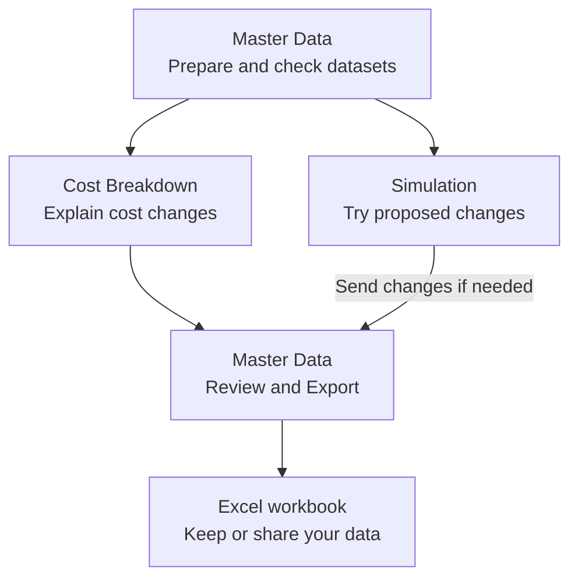

# COSTBREAKDOWN

Understand what changed in product cost, then test the changes you want to make.

COSTBREAKDOWN compares material, labor, and burden costs across datasets. Prepare data in the app or Excel, trace the cost difference to individual materials and operations, and try a what-if scenario before applying it.

[Get started](#get-started) · [Explore the workflow](#from-cost-data-to-a-decision) · [Read the user guide](USER_GUIDE.md)

## From cost data to a decision

Start with the question you need to answer: **What changed?** or **What if we changed it?**

This is a suggested working order ([static overview](docs/images/user-journey.svg)). Cost Breakdown and Simulation are separate analysis paths. After Simulation, Send transfers supported parameter changes to Master Data so you can review and export them.

## Find the answer you need

| Your question | Where to work |
|---|---|
| Is my cost data ready? | **Master Data:** prepare Reference, Current, and Custom; check missing values and identity warnings. |
| Why did the cost change? | **Cost Breakdown:** compare any two datasets and trace the Gap through BOM and Routing findings. |
| Would a proposed change pay off? | **Simulation:** adjust supported parameters and economic assumptions; review cost, profit, and break-even results. |
| How do I keep or share the inputs? | **Excel:** download a template, import a compatible workbook, or export the current Master Data dataset. |

## Get started

1. Download `COSTBREAKDOWN.html` from [GitHub Releases](https://github.com/apirak-k/COSTBREAKDOWN/releases).
2. Open the file in a modern browser. It runs directly from `file://`; no installation or local server is needed.
3. Start in **Master Data**. Open **? Help** in the app for the user guide, or follow [Prepare your datasets](USER_GUIDE.md#prepare-your-datasets).

## Keep an Excel copy

**Save creates a checkpoint in the current browser session. Export creates an Excel file you can keep.**

The standalone app stores working data in the current browser session. It has no permanent shared database. Export important work before ending the session.

[Open the user guide](USER_GUIDE.md) for importing data, resolving issues, comparing costs, and sending Simulation changes back to Master Data.
