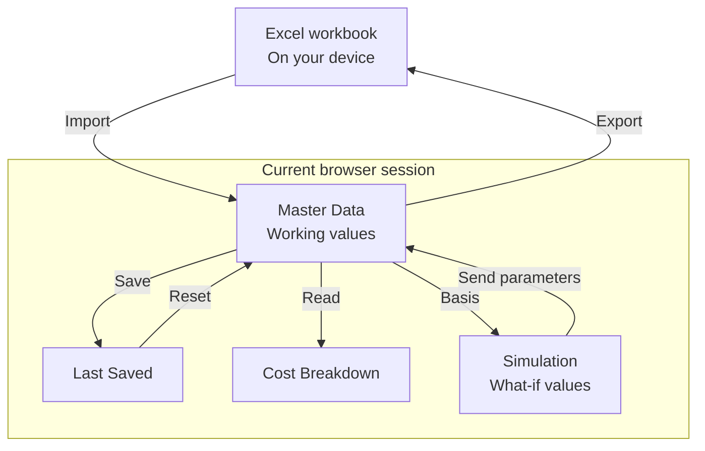

# COSTBREAKDOWN user guide

Prepare your datasets, explain a cost difference, or test a proposed change. The in-app **? Help** is the primary guide; this page adds screenshots and detailed examples.

Screenshots use fictional example datasets. Open an image to view it at full size.

[Start](#start-and-finish-a-session) · [Prepare data](#prepare-your-datasets) · [Resolve issues](#resolve-warnings-and-blockers) · [Compare costs](#explain-a-cost-difference) · [Simulate](#try-a-what-if-scenario) · [Save and Export](#keep-your-work) · [Troubleshooting](#troubleshooting)

## Start and finish a session

Open `COSTBREAKDOWN.html` in a modern browser. It runs directly from `file://` without installation or a local server. Your work stays in the current browser session.

Choose a work area from the top navigation:

| Work area | Use it for |
|---|---|
| Master Data | Prepare the inputs used by the analyses. |
| Cost Breakdown | Explain the difference between two datasets. |
| Simulation | Test proposed parameter changes and economic assumptions. |

Before ending the browser session, [export important datasets](#keep-your-work). Closing the browser session ends the current work session; Export creates the Excel file you can keep.

## Prepare your datasets

### Choose where the data belongs

In **Master Data**, select **Reference**, **Current**, or **Custom** before editing or importing. Each is an independent dataset. A useful starting arrangement is an agreed baseline in Reference, the latest data in Current, and an alternative in Custom. Custom has no fixed business status.

Select the pencil control for **Edit** mode. Enter product information and work through the tables:

| Table | Inputs to prepare |
|---|---|
| BOM | Material, Usage, Unit, Price, and Loss. |
| Work Centers (WC) | Work Center identity, Labor Rate, and Burden Rate. |
| Routing (RTG) | Process, its Work Center, Manning, Capacity, and Yield. |

Routing must link to the intended Work Center in the same dataset. Use notes for context, search to find rows, and BOM / WC / RTG / All to control which tables are shown. You can add, delete, and reorder rows in Edit mode.

### Start from another dataset

Select the **destination** dataset, open **Clone from**, and choose the source. For example, select Custom and clone from Current to prepare an alternative.

Clone replaces the destination's current **Working** values. Its **Last Saved** checkpoint stays unchanged. Review the destination before continuing.

### Bring data in from Excel

1. Open **Sizing** in Master Data. Set the BOM, Work Center, and Routing row counts.
2. Choose **Download Template**, then fill the workbook in Excel. Keep the required sheets and headings intact.
3. Return to Master Data and select the **destination** dataset.
4. Open **Import**, choose a compatible `.xlsx` file, and review the workbook summary and warnings.
5. Choose **Import** in the dialog to apply a valid workbook. Selecting the file alone does not replace your data.

Import replaces the selected dataset's Working values and leaves Last Saved unchanged. An invalid workbook cannot be applied. If the warning list is long, expand **Import warnings** and scroll within it.

You can also use **Apply Sizing** to change row counts directly in Master Data. Download Template uses the counts in the form without requiring Apply Sizing first. The limits are **BOM 1,000**, **Work Centers 500**, and **Routing 500** rows. Review existing data before reducing a table's size. [View the Sizing dialog](docs/images/sizing.png).

## Resolve warnings and blockers

Open the header **i** button to view **Prepare Dataset**. Select a dataset row to filter its issues, then expand a Warning or Blocker category.

| Issue | What to check |
|---|---|
| Generated identity | A row received a generated name. Confirm that it identifies the intended material, Work Center, or process. |
| Auto-renamed duplicate | A duplicate name was renamed. Check whether the rows represent distinct items and give them appropriate identities. |
| Missing required value | Enter the required data shown by the Blocker. |

Select an affected location to open the correct dataset and table, select the row, and focus the target field. Correct it in Edit mode, then review the issue list again. [See a field reached through an issue](docs/images/jump-to-field.png).

The overall readiness indicator concerns **Reference and Current**. Custom's issues are shown but do not determine that pair's readiness. Warnings call for review; Blockers can keep the pair from being ready. Check **Product Match / Product Mismatch** to confirm that you are comparing the intended product.

## Explain a cost difference

Open **Cost Breakdown** and choose **Before** and **After**. The default is **Reference → Current**; either side can use any of the three datasets. Analysis uses the latest Master Data **Working** values, so you can compare edits before saving a checkpoint.

**Standard Cost Gap = After − Before.** A positive Gap means After costs more; a negative Gap means it costs less. Standard Cost combines Material, Labor, and Burden.

Read the cost overview, then use the BOM and Routing findings to locate the contributors. The Work Center panel supplies conversion-cost context. Filter by table or status, and sort the findings as needed.

Findings are marked **ADDED**, **REMOVED**, **CHANGED**, or **UNCHANGED**. Expand a changed finding to inspect Before, After, and **Parameter Cost Effect** details.

### Focus on a few findings

Select a numbered row button on the left of a BOM or Routing finding. The overview shows its **Selected** contribution beside the full Gap. Select more findings to study them together; select a row again to remove it from the focus.

Here, the selected finding contributes **+4.20** to the full **+16.05** Standard Cost Gap. The full comparison remains visible.

Changing the Before/After pair or its Working data clears the selected membership. Selected Comparison belongs to Cost Breakdown. It does not change Master Data or control Simulation.

## Try a what-if scenario

For a separate proposal, a useful starting point is **Master Data → Custom → Clone from → Current**. Then open **Simulation**. Simulation initially has **Custom active** and compares **Current → Custom** in Result.

### Choose the workspace and the comparison

| Control | What it determines |
|---|---|
| Underlined dataset beneath Cost Structure | The active dataset for editing, Send, and Reset. |
| Before / After in Result | The two scenarios displayed in Result. |

Selecting a dataset beneath Cost Structure also sets Result's After dataset. You can then change the Result pair independently. **Send still follows the underlined active dataset**, even if Result's After selector shows another role.

### Change the proposal and read the result

Edit **BOM Price, Usage, and Loss**, or **Routing Manning, Capacity, and Yield**. Work Center rates, identities, and table structure are changed in Master Data. Simulation row statuses compare the active scenario with that role's Master Data basis.

Use the Business and Economic panel for **Selling Price**, **SG&A %**, **Variable Action Cost**, **Fixed Action Cost**, and **Batch Size**. These assumptions are used only by Simulation for profit and break-even analysis.

- **Cost Structure** shows cost components and business outcomes across the datasets. Use the legend to show or hide components; Show all restores them.
- **Result** compares the chosen Before and After scenarios, including Standard Cost and Operating Profit.
- **Break-even** compares cumulative parameter savings with total action cost across production quantities. Review where the lines meet and the outcome at your Batch Size.

Simulation starts from Master Data Working values. If you change a role's Working data in Master Data, that role's existing scenario is rebuilt from the updated basis. Review or finish the scenario before changing its source data.

### Keep or discard the proposal

To use the parameter changes, confirm the active dataset and choose **Send** (the paper-plane icon). Return to the **same role** in Master Data to review the result. Send copies supported BOM/Routing parameters into Working values; it leaves Last Saved unchanged. Selling Price / SG&A overrides, action costs, and Batch Size are not sent to Master Data. Updating the Working basis through Send can also reset that role's scenario assumptions.

Use **Save** in Master Data to checkpoint the sent values, or **Export** to create an Excel copy.

To discard the active scenario, choose **Reset**. It restores that role's parameter values to the current Master Data basis and restores its business/economic defaults. It keeps the active dataset and Result selectors unchanged.

The secondary **Send all datasets** and **Reset all** actions are available by hovering over the control, or focusing it and pressing **Alt + Down Arrow**:

| Action | Effect |
|---|---|
| Send all datasets | Sends each Simulation role's supported parameters to its matching Master Data Working role. |
| Reset all | Resets all three scenarios and restores active Custom with Result Current → Custom. |

Simulation Reset actions leave Master Data unchanged.

## Keep your work

Working values, Last Saved checkpoints, and Simulation belong to the current browser session. There is no permanent shared database. **Export important work before ending the session.**

Each role has its own Last Saved checkpoint and Simulation scenario. Send returns supported parameters to the matching Working role.

### Save a checkpoint during the session

**Save** copies the selected Master Data dataset's Working values into Last Saved. **Reset** restores that checkpoint. If none exists, Reset uses the dataset's initial reset basis, which can be established by Import.

**Clear** blanks editable Working values while keeping the table structure and Last Saved. Clone, Import, and Simulation Send also leave Last Saved unchanged. Use the header Undo/Redo controls to step through supported Master Data Working edits.

Save, Reset, and Clear act on the selected role. Their all-dataset actions apply to Reference, Current, and Custom together; access them by hovering over the control or pressing **Alt + Down Arrow** while it has focus.

### Export a file to keep or share

In **Master Data**, select the dataset and choose **Export**. The workbook contains its current Working data, including unsaved edits and parameters received through Send. Repeat for each dataset you need to keep.

Save does not create a file. Export does not require Save first. Cost Breakdown and Simulation have no separate Export command; send supported scenario parameters back to Master Data before exporting them. Simulation-only economic assumptions are not included through Send.

## Troubleshooting

| What happened | What to do |
|---|---|
| The app does not open | Open `COSTBREAKDOWN.html` in a modern browser. If it still does not open, ask for an approved copy or support. |
| Reference or Current is Incomplete | Open header i → Prepare Dataset, expand Blockers, and select an affected location. |
| Import says Invalid | Use a compatible `.xlsx` workbook. Start with Download Template and preserve its required sheets and headings. |
| A field cannot be edited | Check Master Data Edit mode, or the supported Simulation fields listed above. |
| Send affected an unexpected role | Check the underlined active dataset beneath Cost Structure, then review that same role in Master Data. Result's After selector does not choose the Send destination. |
| Data is missing in a new session | Import an exported workbook. Last Saved is a session checkpoint, not a permanent backup. |

[Back to the product overview](README.md)
