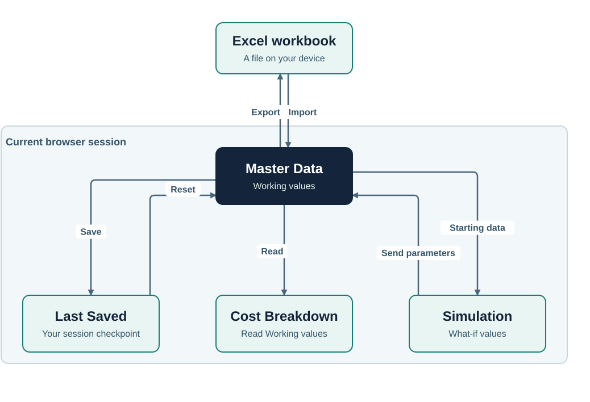

# COSTBREAKDOWN user guide

Prepare your data, choose an analysis, then keep the inputs you need.

[Master Data](#prepare-your-data) · [Cost Breakdown](#explain-a-cost-change) · [Simulation](#try-a-change) · [Keep your work](#keep-your-work)

Excel brings inputs to Master Data. Cost Breakdown reads Working values; Simulation tests a proposal and can send supported changes back. Export creates a workbook you can keep.

Screenshots show the real app with example data. Numbers match the notes below each image. Open an image at full size to read small controls.

## Open the app

Double-click **COSTBREAKDOWN.html**. It opens directly in your browser from the file, with no local server or runtime installation.

## Prepare your data

Open **Master Data**. Choose the dataset that should receive your changes before editing or importing.

| Marker | What to do |
|---|---|
| 1 | Choose Reference, Current, or Custom. Each holds its own data. |
| 2 | Use View/Edit and the dataset actions. Hover over an icon to see its name. |
| 3 | Search rows. Choose BOM, WC, RTG, or All to change the table view. |
| 4 | Select row numbers for group actions in Edit mode. Rows 1 and 3 are selected here. |
| 5 | Use Value to preview supported numbers or edit the focused numeric field. |
| 6 | Open Prepare Dataset to check readiness, warnings, and blockers. |

Reference can hold your baseline, Current your latest inputs, and Custom an alternative. You can compare any two datasets.

### Enter data or use Excel

Select the pencil for Edit mode. Enter the product details, then fill the tables:

| Table | Inputs |
|---|---|
| Bill of Materials (BOM) | Material, Usage, Unit, Price, and Loss. |
| Work Centers (WC) | Work Center, Labor Rate, and Burden Rate. |
| Routing (RTG) | Process, Work Center, Manning, Capacity, and Yield. |

Each Routing Work Center must refer to the intended center in the same dataset.

To start from Excel:

1. Open **Sizing**, set the row counts, and choose **Download Template**.
2. Fill the workbook in Excel. Keep the required sheets and headings.
3. Select the destination dataset in Master Data and open **Import**.
4. Choose your `.xlsx` file. Review its status, row counts, and warnings.
5. Choose **Import** to apply a valid workbook. Selecting a file alone does not replace data.

Import replaces the destination's Working data. Invalid workbooks cannot be applied. Expand **Import warnings** to read a long list.

**Apply Sizing** changes row counts in Master Data. Download Template uses the form's counts without requiring Apply Sizing first. Limits are BOM 1,000, Work Centers 500, and Routing 500. Reducing counts removes rows from the end, so check your data first.

To copy existing data, select the destination, open **Clone from**, and choose the source. For example, clone Current into Custom to prepare an alternative. Clone replaces the destination's Working data.

You can add, delete, and reorder rows in Edit mode. Selecting rows supports group actions; it does not limit analysis or Export.

### Check the data

Open **i**, then expand a Warning or Blocker category. Select an affected location to reach its dataset, table, row, and field.

- **Warnings:** review generated names and renamed duplicates.
- **Blockers:** fill the required inputs identified by the issue.

The readiness indicator concerns Reference and Current. Custom's issues do not determine that pair's readiness. Check Product Match / Product Mismatch before comparing.

**Saved** means Working matches Last Saved. **Draft** means it differs, or no checkpoint exists. These labels describe the checkpoint state, not whether the inputs are complete.

### Read and edit numbers

Numbers may be shortened or use scientific notation. Hover over a supported number to preview it in **Value**. Click a read-only number to pin or unpin it.

Focus an editable numeric field to see its input value. You can also edit that field through Value. Display formatting does not change stored values.

## Explain a cost change

Open **Cost Breakdown**. The default pair is Before = Reference and After = Current. Analysis uses current Master Data Working values, including unsaved edits.

| Marker | What to do |
|---|---|
| 7 | Choose Before and After. Either can use any of the three datasets. |
| 8 | Read the cost overview and Work Center contributions. |
| 9 | Read Selected beside the full Gap to see the contribution of chosen findings. |
| 10 | Select a BOM or Routing row number. Select it again to remove it from the focus. |
| 11 | Expand a CHANGED row to compare its inputs and Parameter Cost Effects. |
| 12 | Choose BOM, RTG, or All. Filter and sort to find the rows you need. |

**Standard Cost Gap = After − Before.** A positive Gap means After costs more. A negative Gap means it costs less.

In this example, the full Gap is **+16.05**. MAT-A contributes **+4.20**, caused by its Price changing from **10.00** to **12.00**. Selecting more findings combines their contributions while the full Gap stays visible.

For CHANGED rows, parameter columns show After minus Before. ADDED and REMOVED rows show values from the side where they exist. UNCHANGED rows have no business change.

Changing the comparison pair or its source data clears the selected findings. Selected Comparison belongs to Cost Breakdown; it does not change data or control Simulation.

## Try a change

Open **Simulation** to test a proposal. To test a copy of Current, clone it into Custom in Master Data first.

A new Simulation starts with Custom active and Result set to Current → Custom.

| Marker | What to do |
|---|---|
| 13 | Choose the active dataset below Cost Structure. The underlined dataset is used for editing, Send, and Reset. |
| 14 | Choose the Before and After scenarios displayed in Result. |
| 15 | Read Cost Structure. Use its legend to show or hide components; Show all restores them. |
| 16 | Try BOM Price, Usage, and Loss, or Routing Manning, Capacity, and Yield. Expand rows for effect details. |
| 17 | Set Selling Price, SG&A, action costs, and Batch Size for profit and break-even analysis. |
| 18 | Send the active proposal to Master Data, or Reset that scenario. |

Choosing an active dataset also sets Result's After. You can then change the Result pair separately. **Send follows the active dataset, even when Result's After shows another dataset.**

Here, Custom's MAT-A Price is **11.00**, compared with **12.00** in its Master Data inputs. Result shows how the proposal changes cost and profit. Break-even compares cumulative parameter savings with total action cost across production quantities.

Select rows to bring them to the top of the scenario table. This does not filter Result or limit Send.

### Use or discard the proposal

| Action | Effect |
|---|---|
| Send | Copies supported BOM/Routing parameters into the active dataset's Master Data Working values. |
| Reset | Restores the active scenario from its current Master Data inputs and default assumptions. Keeps the active dataset and Result pair. |
| Send all datasets | Sends each scenario's supported parameters to its matching Master Data dataset. |
| Reset all | Resets all scenarios and restores active Custom with Result Current → Custom. |

Hover over Send or Reset, or focus it and press **Alt + Down Arrow**, to access the all-dataset actions.

Work Center rates, names, and row structure are edited in Master Data. Selling Price / SG&A overrides, action costs, and Batch Size stay in Simulation. Send does not copy them back.

Changing a dataset's source Working data rebuilds its scenario and assumptions. This can also happen after Send. Review or record your proposal before changing its source data. Simulation Reset actions leave Master Data unchanged.

## Keep your work

Working data, checkpoints, and scenarios belong to the current browser session. Closing the browser ends that working session, so Export the data you want to keep as an XLSX file before closing it.

| Master Data action | Effect |
|---|---|
| Save | Copies the active dataset's Working data into its Last Saved checkpoint for the current browser session. |
| Reset | Restores Last Saved, or the initial reset state if no checkpoint exists. Import can establish that initial state. |
| Clear | Blanks editable Working values while keeping the row structure. |
| Export | Creates a persistent XLSX file from the active dataset's current Working values, including unsaved edits. |

Import, Clone, Clear, and Simulation Send leave Last Saved unchanged. Use the header Undo/Redo controls for supported Master Data Working edits.

Save, Reset, and Clear act on the selected dataset. Hover over the control, or focus it and press **Alt + Down Arrow**, for the all-dataset action.

Save is a browser-session checkpoint; it does not create a file. Export does not require Save first and creates an XLSX file you can keep after closing the browser. To keep a proposal's parameters, Send them to Master Data before Export. Record Simulation-only assumptions separately.

## Help opening the app

| Problem | What to do |
|---|---|
| The file opens as text or in an editor | Open `COSTBREAKDOWN.html` with your browser, or use the browser's Open File command. |
| I need to keep work after closing the browser | Export the datasets you need as XLSX files before closing the browser. |

[Back to COSTBREAKDOWN](README.md)
