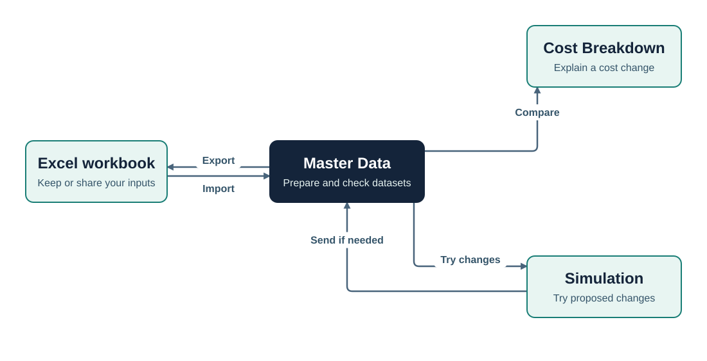
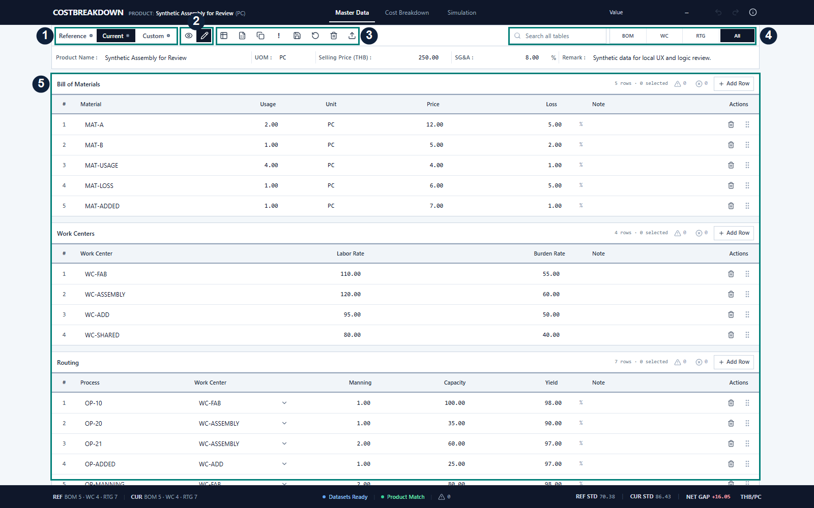
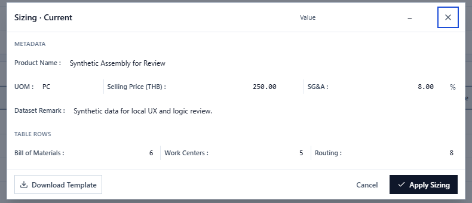
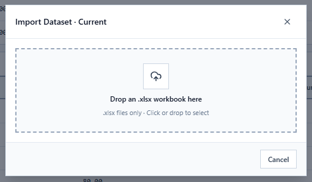
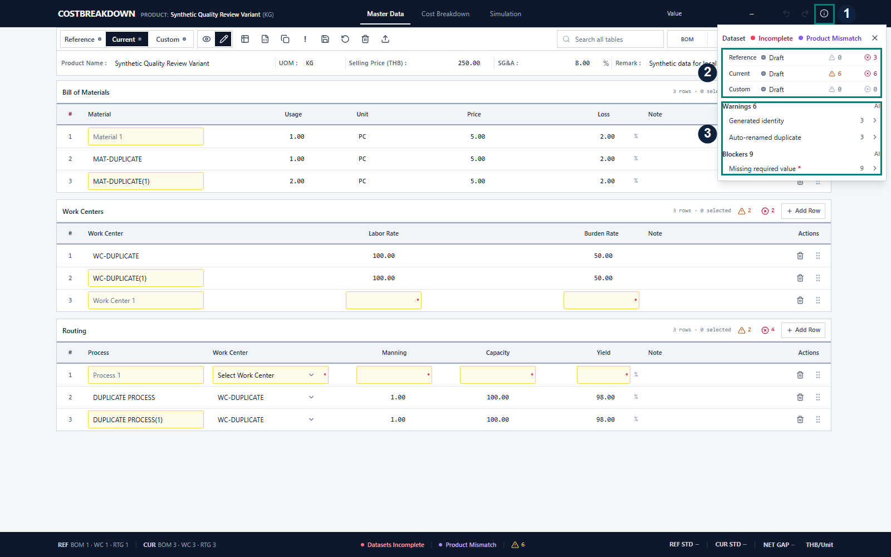
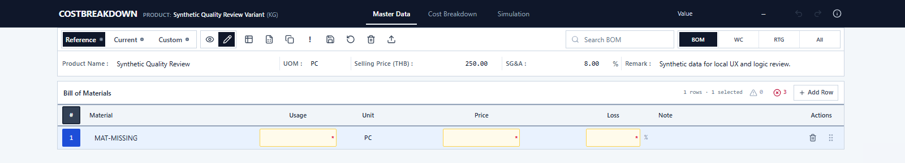
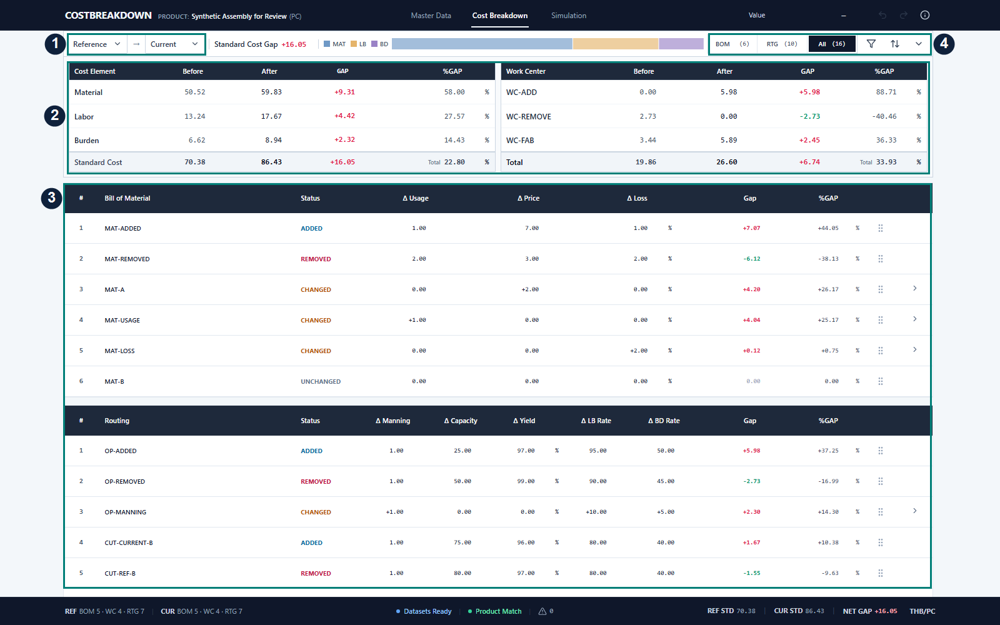
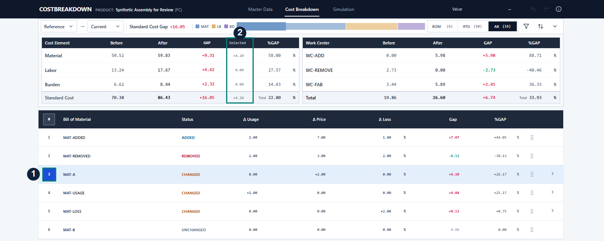
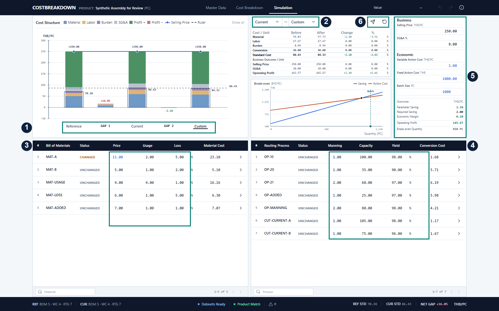

# COSTBREAKDOWN User Guide

Prepare the cost data you want to study, compare it, and test proposed changes before deciding which values to use.

[Open the app](#open-the-app) · [Prepare data](#prepare-your-cost-data) · [Check data](#check-the-datasets) · [Compare costs](#compare-costs) · [Try a scenario](#try-a-scenario) · [Keep your work](#keep-your-work-and-close-the-app) · [Troubleshooting](#troubleshooting)

## Follow the main workflow

This is a suggested working order. Cost Breakdown and Simulation are available as separate analysis paths; use the one your question needs. Both use the latest Master Data Working values.

Screenshots show the current application with fictional example data. Open an image to view its controls at full size.

## Open the app

1. Download the package supplied by your company and extract the complete ZIP into a folder. Keep the package folders together.
2. Choose the launcher for your operating system:
   - **Windows:** double-click `Windows/Start COSTBREAKDOWN.exe`.
   - **macOS:** open `macOS/Start COSTBREAKDOWN.app`. This package is not signed or notarized; if macOS blocks it, do not bypass Gatekeeper—ask your company administrator for an approved build.
   - **Linux:** open `Linux/Start COSTBREAKDOWN` or `Linux/Start COSTBREAKDOWN.desktop`. Your desktop environment may ask you to trust the downloaded launcher first.

COSTBREAKDOWN starts a local server and opens in your default browser. Starting the same package again reuses its running server.

Starting the same package again reuses the running app. You do not need to start a second copy.

The top navigation has three work areas:

| Page | Use it to answer |
|---|---|
| Master Data | What data am I working with, and is it ready? |
| Cost Breakdown | What changed between these two datasets? |
| Simulation | What would happen if I changed these values? |

## Prepare your cost data

Start in **Master Data**. Choose the dataset you want to work on before editing, importing, or using its toolbar actions.

| Marker | Where to look | What to do |
|---|---|---|
| 1 | Reference / Current / Custom | Select the dataset that should receive your changes. |
| 2 | Eye and pencil controls | Use View to inspect data and Edit to change it. |
| 3 | Action toolbar | Hover over an icon to see its name. This group contains Sizing, Import, Clone from, warning highlights, Save, Reset, Clear, and Export. |
| 4 | Search and BOM / WC / RTG / All | Find a row or choose which tables to display. |
| 5 | Cost tables | Enter values in Edit mode; use Add Row when more rows are needed. |

### Choose the dataset

| Dataset | Intended use |
|---|---|
| Reference | A reference set of cost data for comparison. |
| Current | The current set you want to review. |
| Custom | A third independent workspace for another set of data. It has no fixed business status. |

For example, keep an agreed reference in Reference, put the latest values in Current, and use Custom for an alternative. These are choices for your work; the app lets you compare any two roles.

### Know the tables

| Table | Important fields |
|---|---|
| BOM | Material identifies the item; Usage is the quantity used; Unit describes that quantity; Price is its unit price; Loss is the loss percentage. |
| Work Centers (WC) | Work Center identifies the center. Labor Rate and Burden Rate hold its cost rates. |
| Routing (RTG) | Process identifies the operation; Work Center links it to a center; Manning is staffing; Capacity is production capacity; Yield is the good-output percentage. |

Note fields let you record context. Work Center links in Routing should refer to the intended center in the same dataset.

### Enter data or copy a starting point

Select the pencil control to enter Edit mode. Update product information and table cells, then review the values. Master Data also supports adding, deleting, and reordering rows. Use the eye control to return to View.

To start from another dataset:

1. Select the **destination** dataset, such as Custom.
2. Open **Clone from** and choose the source, such as Current.
3. Review the copied values in the destination, then make your changes.

Clone replaces the destination's Working data. It leaves its Last Saved checkpoint unchanged.

### Set row counts or get an Excel template

Open **Sizing** from the toolbar.

- Set the required counts for **Bill of Materials**, **Work Centers**, and **Routing**.
- Choose **Apply Sizing** to apply those counts to the active Working dataset. Review existing data before reducing a table's size.
- Choose **Download Template** to create an Excel workbook using the counts currently shown in the form. You can download the template without first applying the counts to Master Data.

Sizing prepares the rows; you still need to enter or import the cost values.

### Fill the template and Import

**Download Template → fill the Excel workbook → select the destination dataset → Import → review the result → Import to apply.**

1. Fill the template in Excel, keeping its required sheets and headings intact.
2. In Master Data, select the dataset that should receive it.
3. Open **Import**. Choose a compatible .xlsx workbook or drop it into the file area.
4. Review the workbook status, product name, and table row summary.
5. Select **Import** to apply a valid workbook. An invalid workbook cannot be imported.

Selecting a file only checks it. The final Import action replaces the active dataset's Working data and leaves Last Saved unchanged. Check the destination in the dialog title before confirming.

### Save a checkpoint or undo Working changes

**Working** means the values currently in Master Data. **Last Saved** is the checkpoint created by Save. Both belong to the current browser session.

| Action | Effect |
|---|---|
| Save | Copies the active dataset's Working data to Last Saved. |
| Save all datasets | Saves a checkpoint for Reference, Current, and Custom together. |
| Reset | Restores the active dataset from Last Saved. If it has no saved checkpoint, restores its initial reset state. |
| Reset all datasets | Applies that reset behavior to all three datasets. |
| Clear | Blanks editable values in the active dataset while keeping the table structure. Last Saved is unchanged. |
| Clear all datasets | Clears Working values in all three datasets while keeping their table structures and Last Saved checkpoints. |

Clicking Save, Reset, or Clear acts on the selected dataset. To access the all-dataset action, hover over its icon, or focus it and press **Alt + Down Arrow**.

Save is useful when you want a version to Reset to during your work. **Use Export for an Excel copy you can keep after the browser session ends.** You can compare and simulate Working data without saving it first.

## Check the datasets

Open the header **i** button, **Prepare Dataset**, to review readiness and issues.

| Marker | What it shows |
|---|---|
| 1 | The header i button that opens Prepare Dataset. |
| 2 | Dataset status, save state, and issue counts. Select a dataset row to filter the issue list. |
| 3 | Warning and Blocker categories. Expand a category to see the affected locations. |

**Warnings** identify items to review. They do not automatically mean that the dataset is unusable. **Blockers** identify missing required data and can keep Reference or Current from being ready.

The readiness indicator concerns Reference and Current. Custom's issues are listed, but do not determine that pair's readiness. Check Product Match / Product Mismatch as well to confirm that the datasets describe the product you intend to compare.

### Jump to the field that needs attention

1. Expand a Warning or Blocker category.
2. Select an affected location.
3. The app opens the relevant dataset and table, selects the row, and focuses the target field.
4. Correct the value in Edit mode and review the issue list again.

Once the necessary inputs are ready, choose the analysis path you need below.

## Compare costs

Open **Cost Breakdown** to explain the difference between two datasets.

| Marker | What to do |
|---|---|
| 1 | Choose Before and After. The initial pair is Reference → Current; either side can use Reference, Current, or Custom. |
| 2 | Read Standard Cost Gap and the Material, Labor, and Burden breakdown. The adjacent Work Center panel shows conversion cost by center. |
| 3 | Review BOM and Routing findings to identify the materials or processes contributing to the difference. |
| 4 | Use BOM / RTG / All, status filters, and sorting to find the relevant findings. |

**Standard Cost Gap = After − Before.** A positive gap means After costs more; a negative gap means it costs less. Standard Cost combines Material, Labor, and Burden.

Findings show **ADDED**, **REMOVED**, **CHANGED**, or **UNCHANGED**. Open a changed finding with its disclosure arrow to inspect Before, After, and **Parameter Cost Effect** details. These details help distinguish which changed inputs contribute to the cost effect.

### Focus on selected findings

Select one or more numbered row-selection buttons at the left of the BOM or Routing findings. The overview adds a **Selected** contribution beside the full gap.

Marker **1** is the row-selection button; marker **2** shows the Selected contribution in the overview.

In this example, the selected finding contributes **+4.20**, while the full Standard Cost Gap remains **+16.05**. The selection helps investigate a subset; the full findings and Work Center context remain available.

Click a selected row button again to unselect it. Changing the Before/After pair or its Working data clears the selected membership. Selected Comparison does not change Master Data and does not control Simulation.

## Try a scenario

Open **Simulation** when your question is about a proposed change. It starts from Master Data and keeps what-if changes separate until you Send them back.

| Marker | What to do |
|---|---|
| 1 | Select Reference, Current, or Custom beneath Cost Structure to choose the dataset you will edit. The active label is underlined. |
| 2 | Choose the Before/After pair displayed in Result. |
| 3 | Change supported BOM values. |
| 4 | Change supported Routing values. |
| 5 | Enter Business and Economic assumptions. |
| 6 | Use Send or Reset for the active Simulation dataset. |

### Choose what you will edit

By default, **Custom** is active and Result compares **Current → Custom**. To start Custom from Current, first use **Master Data → Custom → Clone from → Current**.

Selecting a dataset name beneath Cost Structure makes it active for parameter editing and also sets Result's After dataset. You can then choose Result's Before and After independently. Changing those Result selectors changes the comparison displayed; **Send still targets the active dataset under Cost Structure**.

### Adjust the proposed changes

| Area | Editable values |
|---|---|
| BOM | Price, Usage, Loss |
| Routing | Manning, Capacity, Yield |

Work Center rates and table structure are read-only in Simulation; make those changes in Master Data. Row statuses compare the active Simulation values with that role's current Master Data basis.

| Assumption | Use it for |
|---|---|
| Selling Price | The selling-price assumption for the scenario. |
| SG&A % | The selling, general, and administrative expense assumption used in business outcomes. |
| Variable Action Cost | Additional action cost per unit. |
| Fixed Action Cost | The fixed cost of carrying out the action. |
| Batch Size | The production quantity used to evaluate the action. |

These assumptions support the business and break-even analysis; they do not change Standard Cost inputs in Master Data.

### Read the outcome

| View | What to look for |
|---|---|
| Cost Structure | Compare the datasets' cost components and business outcomes. Click legend entries to show or hide components; Show all restores them. Dataset labels beneath the graph choose the active workspace. |
| Result | Compare the selected Before and After datasets, including Standard Cost, Selling Price, SG&A, and Operating Profit. |
| Break-even | Compare cumulative parameter savings with total action cost at different production quantities. Review where Saving and Action Cost meet. Batch Size can be changed in the Economic panel or using the graph's batch marker. |

Review the inputs and assumptions before using the outcome to make a decision.

### Reset an experiment

**Reset** restores the active Simulation dataset's what-if values to its current Master Data basis. Hover over Reset to access **Reset all**, which restores all three Simulation datasets. These actions affect Simulation; Master Data is unchanged.

### Send the changes you want to use

1. Confirm the active dataset under Cost Structure. This determines the Send destination.
2. Choose **Send** (the paper-plane icon). To send all three roles, hover over it and choose **Send all datasets**. The secondary actions are also available with **Alt + Down Arrow** when the control has focus.
3. Return to **Master Data** and select the matching dataset to review the sent values.
4. Choose **Save** if you want those values as the role's Last Saved checkpoint. Use **Export** if you need an Excel copy.

| Command | Destination |
|---|---|
| Send | Active Reference → Reference, Current → Current, or Custom → Custom. |
| Send all datasets | All three Simulation roles → their matching Master Data roles. |

Sending copies BOM and Routing parameter changes into Master Data Working data. It does not update Last Saved. Simulation-only assumptions, including action costs, Batch Size, and Selling Price / SG&A overrides, stay in Simulation.

## Keep your work and close the app

1. Return to **Master Data** and select the dataset you want to keep.
2. Choose **Export**. It creates an Excel workbook from that dataset's current Working data, including edits not yet saved with Save and values received from Simulation.
3. Repeat Export for each dataset you need to keep. Store the files somewhere you can find them again.
4. When finished, use the matching Stop launcher from the same package folder:
   - **Windows:** `Windows/Stop COSTBREAKDOWN.exe`.
   - **macOS:** `macOS/Stop COSTBREAKDOWN.app`.
   - **Linux:** `Linux/Stop COSTBREAKDOWN` or `Linux/Stop COSTBREAKDOWN.desktop`.

Master Data, Last Saved checkpoints, and Simulation work are temporary browser-session data. They are not a permanent company database or shared backup. Save does not create a file, and Stop does not export your data. Export important work before ending the browser session; you can later Import a compatible workbook into the intended dataset.

Export is available in Master Data. Cost Breakdown and Simulation have no separate Export command. Closing a browser tab alone does not stop the local app.

## Troubleshooting

| What you see | What to try |
|---|---|
| The app does not open | Extract the complete package and use the Start launcher for your operating system. If a restart is needed, run its matching Stop launcher from the same folder, then Start again. |
| Reference or Current is Incomplete | Open header i → Prepare Dataset. Expand a Blocker category and select a location to reach the field. |
| A workbook is Invalid | Use Download Template in Sizing. Check that the file is .xlsx and its required sheets and headings are intact. |
| A value cannot be edited | Check that Master Data is in Edit mode. In Simulation, only the supported fields listed above are editable. |
| Send appears to affect a different dataset than expected | Check the active dataset label under Cost Structure, rather than relying on Result's After selector. Review the same role in Master Data. |
| You want to discard an experiment | Use Simulation Reset or Reset all. For Master Data Working changes, use its own Reset command. |
| macOS prevents the app from opening | This package is not signed or notarized. Do not bypass Gatekeeper; ask your company administrator for an approved signed build. |
| Linux asks whether to trust the launcher | Follow your desktop environment and company policy for downloaded launchers. The package does not change trust settings. |
| Data is absent in a new browser session | Import a previously exported workbook. Do not rely on Save as a permanent backup. |

[Return to the overview](README.md)
