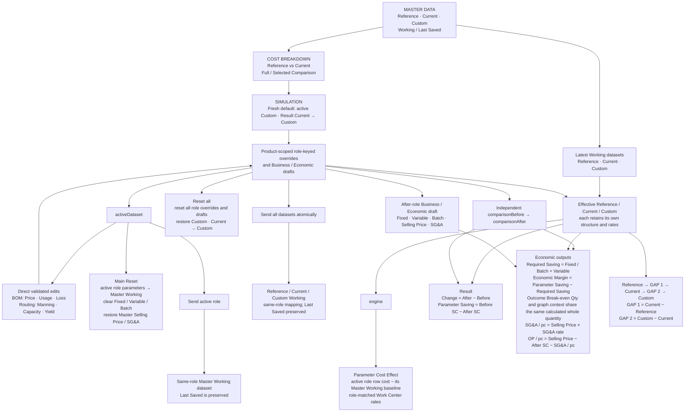

# COSTBREAKDOWN System Logic Diagram

> Current visible product flow and simulation behavior. The canonical requirements are in [`docs/specs/FINAL_LOGIC_SPEC.md`](specs/FINAL_LOGIC_SPEC.md) and [`docs/specs/SIMULATION.md`](specs/SIMULATION.md).

## Current visible page flow

```text
MASTER DATA
(Reference / Current / Custom; Working and Last Saved)
        │
        ▼
COST BREAKDOWN
(Reference vs Current; Full or Selected Comparison)
        │
        ▼
SIMULATION
(Role-local what-if analysis over Reference / Current / Custom)
```

Candidate findings and Selected Comparison remain within Cost Breakdown. There are exactly three visible top-level pages. Historical Candidate/RCA records are not a visible workflow stage.

## Shared dataset calculation

```text
BOM Material Cost = Usage × Price × (1 + Loss)
Routing Factor    = Manning / (Capacity × Yield)
Labor             = Routing Factor × matching role's Work Center Labor Rate
Burden            = Routing Factor × matching role's Work Center Burden Rate
Conversion        = Labor + Burden
Standard Cost     = Material + Labor + Burden
```

All dataset calculations use the shared Standard Cost engine. Missing or invalid required values make affected results unavailable; they are not replaced with zero. Comparisons may use zero only for a genuinely absent side of an ADDED/REMOVED record.

## Simulation lifecycle and data flow



### Lifecycle rules

- A fresh Simulation workspace starts with active Custom and Current → Custom in Result. Reconciliation preserves valid saved roles and pairs; a changed Master Working basis rebases only that role's overrides.
- There is no fourth SIM snapshot or Clone operation. Effective Reference, Current, and Custom datasets keep their latest Master Working structure and their own Work Center rates; Simulation stores role-local parameter overrides and Business/Economic drafts.
- The graph labels set `activeDataset`, which owns parameter editing, Main Reset, same-role Send, and parameter history. The independent `comparisonBefore → comparisonAfter` pair owns Result; its After role owns the Business/Economic draft and history.
- Simulation structure is locked. Structural changes are made in Master Data, then the appropriate role is selected in Simulation.
- Main Reset returns the active role's parameter overrides and commercial drafts to that role's Master Working defaults, clears Fixed / Variable / Batch, and preserves the active role, comparison pair, other roles, Master Data, and valid same-basis selection. It is one undoable role-local operation. Reset All applies that reset to all roles and restores active Custom and Current → Custom; it is not one cross-role Undo transaction.
- `Send` writes the effective active role to its matching Master Working dataset. Send All applies all three same-role mappings atomically. Both preserve Last Saved; a sent role rebases while unrelated roles retain their overrides and history.
- State is isolated per product. Deleted/non-live products do not retain active Simulation state.

### Identity, statuses, and validation

- Match BOM, Work Center, and Routing by canonical business identity, never row position.
- Normal editable rows show `UNCHANGED` or `CHANGED` against the active role's latest Master Working baseline. Missing, ambiguous, or unsafe identities are protected without guessed edits or fabricated attribution; missing effective-role rows cannot be edited or selected.
- Price, Usage, Manning, fixed/variable costs, and Selling Price are nonnegative. Loss and SG&A are 0–100%. Yield is greater than 0% through 100%. Capacity and Batch Size are positive; Batch Size is an integer.
- Invalid inputs are rejected at the input and logic boundaries. No silent clamping or invalid-to-zero conversion. Missing inputs may remain unavailable.
- Negative gaps, Result Change, Parameter Saving, Economic Margin, and OP are valid analytical outcomes.

## Graph meaning

- Dataset bars show MAT, LB, BD, SG&A, and OP as separate series. Standard Cost means MAT + LB + BD.
- The fixed story is Reference → GAP 1 → Current → GAP 2 → Custom; it is independent of the Result pair.
- GAP 1 and GAP 2 contain signed MAT/LB/BD components only: Current − Reference and Custom − Current. Positive is above zero; negative is below zero.
- Selling Price is a separate line/marker. SG&A and OP are not part of Standard Cost or gap bars. Negative OP is shown below zero.
- The draggable THB/pc ruler is a visual aid only; its start-aligned value sits in a bounded gutter immediately to the right of the plot, and it cannot modify datasets, inputs, or calculations.
- Desktop BOM and RTG tables render all filtered rows in continuous vertical scroll bodies about four normal rows high. Each has independent always-visible Material/Process Search, an actual viewport range, and one-row previous/next controls; header selection covers every eligible search match and preserves rows hidden by Search. Narrow layouts retain natural card flow and page scrolling. Tables and the full page do not horizontally scroll.

## Legacy session compatibility (not visible product flow)

Older saved sessions may contain Candidate/RCA case records or RCA-associated Simulation context. Compatibility migration may preserve historical case-domain data where needed. It does not restore standalone Candidate/RCA pages, an RCA handoff, or an active Simulation context strip.
