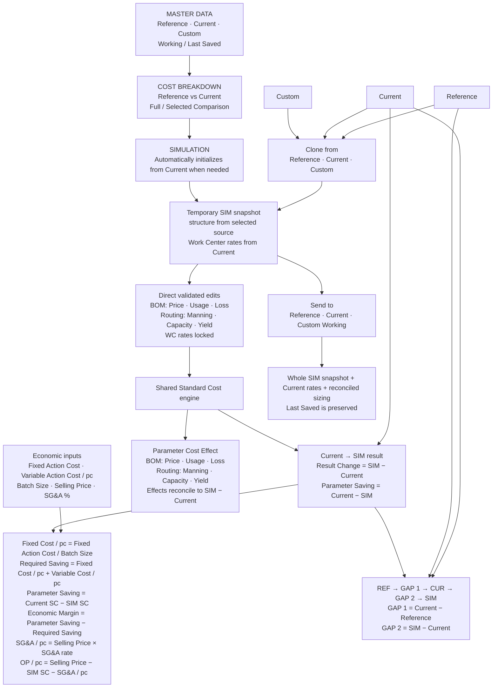

# COSTBREAKDOWN System Logic Diagram

> Current visible product flow and simulation behavior. The canonical requirements are in [`docs/specs/FINAL_LOGIC_SPEC.md`](specs/FINAL_LOGIC_SPEC.md) and [`docs/specs/SIMULATION.md`](specs/SIMULATION.md).

## Current visible page flow

```text
MASTER DATA
(Reference / Current / Custom; Working and Last Saved)
        │
        ▼
COST BREAKDOWN
(Reference vs Current; Full or Selected Comparison)
        │
        ▼
SIMULATION
(Current → SIM analysis; ready-to-work page)
```

Candidate findings and Selected Comparison remain within Cost Breakdown. There are exactly three visible top-level pages. Historical Candidate/RCA records are not a visible workflow stage.

## Shared dataset calculation

```text
BOM Material Cost = Usage × Price × (1 + Loss)
Routing Factor    = Manning / (Capacity × Yield)
Labor             = Routing Factor × Work Center Labor Rate
Burden            = Routing Factor × Work Center Burden Rate
Conversion        = Labor + Burden
Standard Cost     = Material + Labor + Burden
```

All dataset calculations use the shared Standard Cost engine. Missing or invalid required values make affected results unavailable; they are not replaced with zero. Comparisons may use zero only for a genuinely absent side of an ADDED/REMOVED record.

## Simulation lifecycle and data flow



### Lifecycle rules

- On entry, if SIM is missing or stale, create it from the latest Current. Keep valid economic draft inputs when reconciling.
- `Clone from` explicitly replaces the temporary SIM snapshot with Reference, Current, or Custom structure/parameters. SIM Work Center rates always use Current rates. The analytical baseline remains Current → SIM.
- A Current change invalidates/reconciles SIM. A Reference-only or Custom-only change does not reset an existing SIM.
- Simulation structure is locked. Structural changes are made in Master Data / Custom and brought into SIM through `Clone from Custom`.
- `Send to` copies the whole SIM snapshot, including Current-rate context and reconciled sizing, only into the selected target Working dataset. It never silently overwrites Last Saved. Sending to Current triggers baseline reconciliation; sending to Reference or Custom does not by itself reset SIM.
- State is isolated per product. Deleted/non-live products do not retain active Simulation state.

### Identity, statuses, and validation

- Match BOM, Work Center, and Routing by canonical business identity, never row position.
- `UNCHANGED`, `CHANGED`, and `ADDED` are visible/editable when a SIM record exists. `REMOVED` is visible but protected. Missing or ambiguous identity is protected without guessed edits or fabricated attribution.
- Price, Usage, Manning, fixed/variable costs, and Selling Price are nonnegative. Loss and SG&A are 0–100%. Yield is greater than 0% through 100%. Capacity and Batch Size are positive; Batch Size is an integer.
- Invalid inputs are rejected at the input and logic boundaries. No silent clamping or invalid-to-zero conversion. Missing inputs may remain unavailable.
- Negative gaps, Result Change, Parameter Saving, Economic Margin, and OP are valid analytical outcomes.

## Graph meaning

- Dataset bars show MAT, LB, BD, SG&A, and OP as separate series. Standard Cost means MAT + LB + BD.
- GAP 1 and GAP 2 contain signed MAT/LB/BD components only. Positive is above zero; negative is below zero.
- Selling Price is a separate line/marker. SG&A and OP are not part of Standard Cost or gap bars. Negative OP is shown below zero.
- The draggable THB/pc ruler is a visual aid only; it cannot modify datasets, inputs, or calculations.
- BOM and RTG tables and the full page do not horizontally scroll. Tables may scroll vertically and reflow at narrower widths.

## Legacy session compatibility (not visible product flow)

Older saved sessions may contain Candidate/RCA case records or RCA-associated Simulation context. Compatibility migration may preserve historical case-domain data where needed. It does not restore standalone Candidate/RCA pages, an RCA handoff, or an active Simulation context strip.